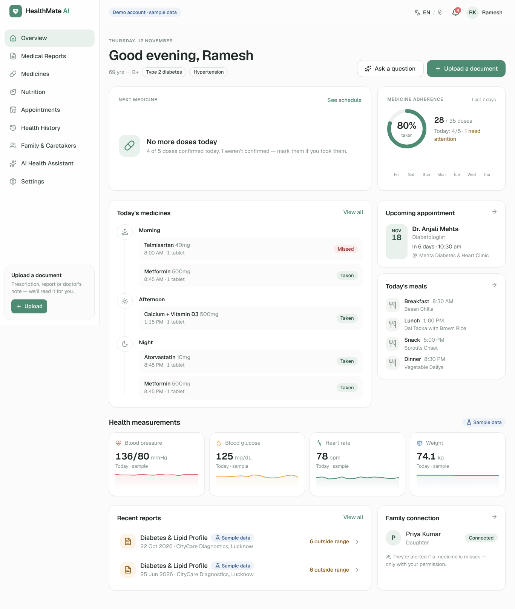
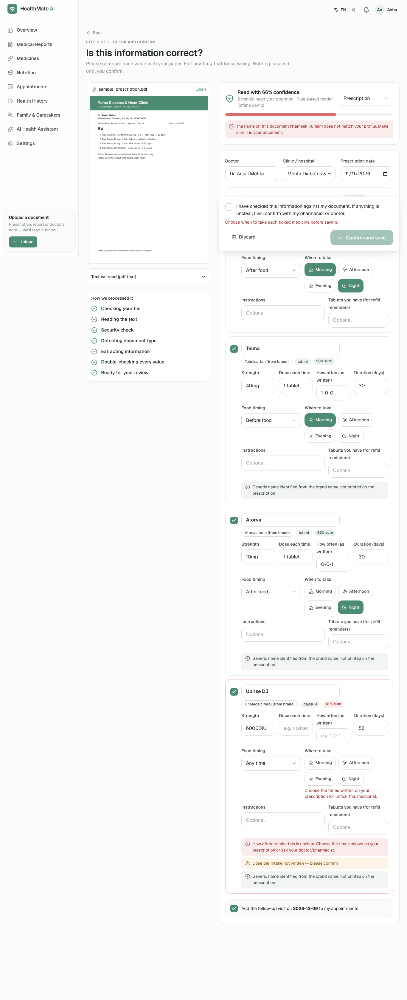
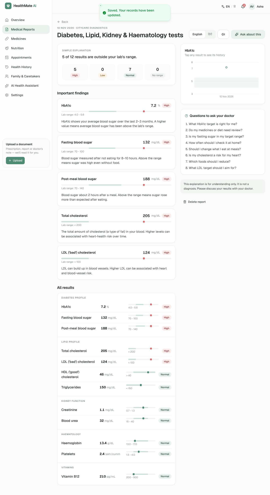
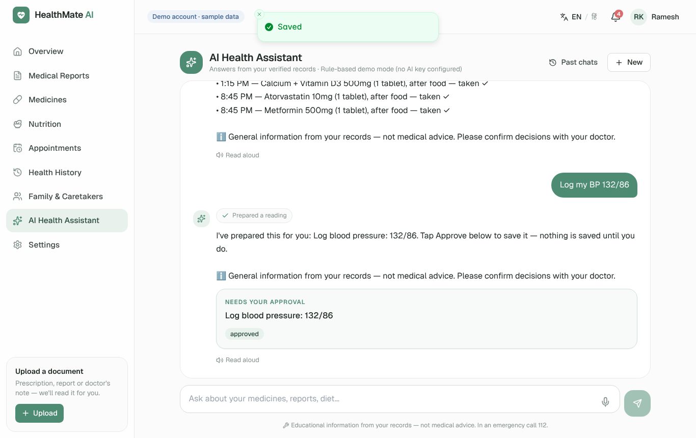

# HealthMate AI

**Your Health. Your Family. One Intelligent Companion.**

HealthMate AI is a personal healthcare companion for elderly patients, people managing chronic conditions, and their family caregivers. **Upload once, understand everything, manage everything from one place**: it reads prescriptions and lab reports, explains them in simple English or Hindi, turns prescriptions into meal-aware voice reminders, plans meals around the doctor's advice, and alerts family members (with consent) when a dose is missed.



---

## Highlights

| | |
|---|---|
| **Document intelligence** | PDF/JPG/PNG upload (drag-drop, file, camera) → OCR (Tesseract eng+hin / PDF text) → multi-agent extraction → grounding & safety validation → confidence scores → **editable verification** → modules update only after the patient confirms |
| **Report analyzer** | Every parameter, unit and *printed* reference range; deterministic high/low/normal; plain-language explanations in EN/HI; questions for the doctor; history and trend charts. Never diagnoses, never invents a range |
| **Prescription analyzer** | Medicine, brand → generic (only if printed or from a known-brand dictionary, labelled), strength, dose, frequency (`1-0-1`, `BD`, `SOS`…), food timing, duration, follow-up. Unclear items are flagged — never guessed |
| **Medicine reminders** | Deterministic schedule from verified prescriptions + the patient's meal times; Taken / Skip / Remind later; adherence; refill alerts; meal-delay rule (bounded, never changes a dose) |
| **Voice reminders** | Device TTS in Hindi or English, voice/volume/speed/repeats; browser notifications; Web Push (VAPID) when configured — limitations are shown honestly in the UI |
| **Nutrition** | Transparent constraint engine: doctor's instructions > allergies/diet > confirmed conditions > report findings > preferences. High-protein foods are blocked when kidney markers are out of range. Weekly planner with swaps, recipes, macros |
| **Family & caregivers** | Up to 3 trusted contacts, invite links, per-person permission toggles, consent ledger, missed-dose escalation, daily summaries, separate caregiver dashboard |
| **AI Health Assistant** | Agentic RAG with tool calling in a ReAct harness: hooks, deterministic guardrails, taint-aware tool gating (prompt-injection defence), human-in-the-loop proposals, memory, traces, AG-UI event stream, bilingual |
| **Privacy & security** | JWT in HTTP-only cookies, RBAC (patient/caregiver), Fernet encryption for files and sensitive columns, audit log, data export, account deletion, privacy-filtered logs |

## Screens

28 routes: landing, sign-in, registration, 5-step onboarding, dashboard, document upload, processing + verification, documents, reports list + analysis, medicine dashboard, today's schedule, prescription upload, nutrition, food detail, weekly planner, meal schedule, appointments, health timeline (with daily check-ins), family & caretakers, AI assistant, notifications, profile, settings (general, privacy & data, AI activity, developer/MCP), voice reminder settings, invitation acceptance and the caregiver dashboard. All of them work on mobile (bottom navigation).

| Verification | Report analysis | Assistant |
|---|---|---|
|  |  |  |

## Tech stack

- **Frontend:** Next.js 14 (App Router), React 18, TypeScript, Tailwind CSS, shadcn-style components on Radix primitives, Lucide, Recharts, Geist font
- **Backend:** Python 3.13, FastAPI, SQLAlchemy 2, Alembic, Pydantic v2, PostgreSQL 16
- **AI:** provider-agnostic client (OpenAI or Gemini over REST, tool calling + JSON mode), offline demo mode, Tesseract OCR, pypdf/pypdfium2, hybrid RAG (BM25 + embeddings, RRF), MCP server (MCP Python SDK v2)
- **Notifications:** Web Push (VAPID via `pywebpush`), service worker, Web Speech API

> **Design decision: no LangChain/LangGraph.** The extraction graph and the agent harness are small, hand-written and fully typed (~600 lines total). That keeps every safety-relevant step (taint gating, guardrails, hooks, tracing) explicit, testable and deterministic without framework indirection. The graph node structure maps 1:1 onto LangGraph if you ever want to swap it in.

## Quick start

### Option A — Docker
```bash
cp .env.example .env              # optionally add OPENAI_API_KEY or GEMINI_API_KEY
docker compose up --build
# open http://localhost:3000 → "Try the demo"
```

### Option B — Local
Requirements: Python 3.11+, Node 20+, PostgreSQL 14+, Tesseract with `eng` + `hin` data.

```bash
# database
createuser -P healthmate            # password: healthmate
createdb -O healthmate healthmate

# backend
cd backend
python -m venv .venv && source .venv/bin/activate
pip install -r requirements.txt
cp ../.env.example .env             # edit as needed
alembic upgrade head
python scripts/generate_samples.py  # sample documents (fictional patient)
python -m app.seed                  # food catalog + demo accounts
uvicorn app.main:app --reload --port 8000

# frontend (new terminal)
cd frontend
npm install
npm run dev                          # http://localhost:3000
```

**Demo accounts** (sample data, clearly labelled in the UI) — or just click *Try the demo*:
- Patient: `demo.patient@healthmate.app` / `demo1234`
- Caregiver: `demo.caregiver@healthmate.app` / `demo1234`

**Enable live AI:** set `LLM_PROVIDER=openai` + `OPENAI_API_KEY` (or `gemini` + `GEMINI_API_KEY`) and restart the API. Extraction, embeddings and the assistant switch to the model; all guardrails, grounding checks and evals stay the same.

**Enable background push:** `python backend/scripts/generate_vapid_keys.py` → paste into `.env` → restart → Settings → Enable notifications.

## Project layout

```
backend/
  app/
    api/routes/          auth, profile, documents, reports, medicines (+meals), nutrition, health (appointments,
                         measurements, check-ins, timeline), family (+caregiver), notifications, assistant, account
    services/
      extraction/        pipeline (multi-agent graph), rules, llm_extractor, validator (grounding/safety), commit
      agent/             harness (ReAct + hooks + AG-UI), tools, guardrails, context, demo_policy
      scheduling.py      deterministic medicine schedule + meal-delay rule + adherence
      reminder_engine.py reminders, escalation to caregivers, refills, appointments, daily summaries
      nutrition.py       constraint engine + weekly planner
      rag.py, ocr.py, llm.py, reports.py, consent.py, notify.py, storage.py, observability.py, audit.py
    models/models.py     28 tables (SQLAlchemy)
  alembic/               migrations
  evals/                 eval harness + cases
  tests/                 pytest (unit + API journeys on PostgreSQL)
  mcp_server.py          read-only MCP server
  sample_docs/           fictional sample documents (incl. a prompt-injection test file)
frontend/src/
  app/                   all routes (App Router)
  components/            design system (ui/), app shell, charts, upload, verification editors, food art…
  lib/                   api client (+SSE), auth, i18n (EN/HI), voice (TTS/STT), push
e2e/journeys.py          Playwright browser journeys
docs/                    API, architecture, agentic AI design, testing
```

## What works vs. what needs credentials

| Feature | Status in this build |
|---|---|
| OCR, PDF parsing, rule-based extraction, grounding/safety validation, verification, all module updates | ✅ Works offline |
| Assistant (tools, RAG, guardrails, HITL, memory, traces, streaming UI) | ✅ Works offline in **demo mode** (deterministic planner, labelled as such) |
| OpenAI / Gemini extraction, assistant and embeddings | 🔑 Implemented; needs an API key. Not exercised in this build's test runs |
| Web Push when the app is closed | 🔑 Implemented (VAPID + service worker); needs keys and a browser push service |
| Voice reminders | ✅ Browser TTS while the app is open (depends on device voices) |
| Invitation email delivery | ⛔ Not configured — the invite link is shown to copy/share (stated in the UI) |
| Food photography | ⛔ Illustrated food art is used; set `FOOD_IMAGES` in `backend/app/seed_data/foods.py` to use licensed photos |
| SMS/WhatsApp alerts | ⛔ Not included (caregiver alerts are in-app + push) |

## Testing

```bash
cd backend && pytest -q                 # 20 tests: safety units + API journeys on PostgreSQL
python -m evals.run_evals               # extraction / hallucination / guardrails / agent scorecard
cd ../frontend && npm run typecheck && npm run build
python e2e/journeys.py                  # 11 browser journeys (needs both servers running)
```
See [docs/TESTING.md](docs/TESTING.md).

## Medical safety

HealthMate never diagnoses, prescribes, changes doses, overrides doctors, invents values or reference ranges, assumes unclear prescription instructions, or shares information with caregivers without consent. These are enforced in code (deterministic validators, guardrails and tool policies), not just in prompts. See [SECURITY.md](SECURITY.md).

*HealthMate AI provides information, not medical advice. In an emergency call 112.*
